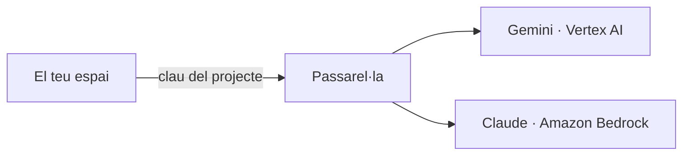

# La passarel·la i el catàleg

## Una sola porta cap als models

Cap programa de l'espai parla directament amb Google, Amazon o Anthropic. Tots parlen amb la
**passarel·la** del Teclab (LiteLLM), que és qui té les credencials dels proveïdors. La
passarel·la ofereix una API compatible amb la d'OpenAI: el client `openai` de Python, Claude
Code i qualsevol eina que sàpia parlar amb OpenAI funcionen sense canvis, només amb l'adreça i
la clau.

Dins de l'espai, l'adreça és la variable `LITELLM_BASE_URL` i la clau, `LITELLM_KEY`. Les posa
la plataforma en crear l'espai; no cal que les escrigues enlloc.



## Àlies, no noms de model

`examples/resum.py` no demana `gemini-2.5-flash`: demana `chat-default`. Un **àlies** és un nom
del catàleg de la passarel·la que apunta a un model concret. Qui administra la passarel·la pot
canviar a quin model apunta sense tocar cap espai ni cap codi.

| Àlies | Per a què | Model hui |
|---|---|---|
| `chat-default` | Ús general, ràpid | `gemini-2.5-flash` |
| `chat-llarg` | Textos llargs, més capacitat | `gemini-2.5-pro` |
| `embed-default` | Incrustacions (vectors) | `gemini-embedding-001` |

Els models de Claude (`claude-haiku-5.5`, `claude-sonnet-5.5`) es criden pel seu nom al
catàleg, i només si la clau del projecte hi té accés. Llista completa a
[Àlies i models](../referencia/alies-models.md).

Per a saber què pot cridar la teua clau, des del terminal de l'espai:

```bash
curl -sS "$LITELLM_BASE_URL/models" -H "Authorization: Bearer $LITELLM_KEY"
```

## Una clau per projecte, amb pressupost

Cada espai té la seua **clau del projecte** (una «clau virtual» de la passarel·la). La crea la
plataforma en crear l'espai, amb tres propietats:

- **Quins models** pot cridar: segons l'accés que l'administrador/a va triar (cap, només Gemini,
  o Gemini i Claude).
- **Quant pot gastar**: un pressupost màxim en dòlars (la unitat de la passarel·la). Quan
  s'esgota, les crides fallen fins que l'administrador/a l'amplia.
- **Qui ha gastat què**: cada crida queda al registre de la passarel·la amb el nom de la clau,
  el model real i els tokens.

La clau viu a l'entorn de l'espai i mor amb ell: en esborrar l'espai, la clau es revoca.
Canviar l'accés o el pressupost genera una clau nova (la vella deixa de servir).

!!! warning "La clau no és teua, és del projecte"
    No la copies a cap fitxer, notebook ni repositori. Si necessites la clau en un programa,
    llig-la de l'entorn (`os.environ["LITELLM_KEY"]`), com fan els exemples.

## L'agent de codi també passa per ací

L'ordre `claude` de l'espai usa la mateixa passarel·la i la mateixa clau: els models que pot
usar i el pressupost són els del projecte. Hi ha un segon mode, `claude-compte`, amb la
llicència de Claude de la UJI de cada persona, que no passa per la passarel·la. Vegeu
[L'agent de codi](../guies/agent-de-codi.md).
